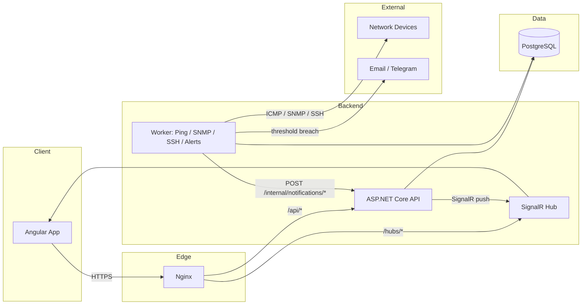

# Architecture

## Overview

Enterprise Network Monitor is split into three deployable units that share
a single Postgres database and a common set of backend libraries:

| Unit | Technology | Responsibility |
|---|---|---|
| **Frontend** | Angular, served by Nginx | Login UI, device CRUD, live dashboard, charts |
| **API** | ASP.NET Core (.NET 10) | REST endpoints, JWT auth, SignalR hub for live updates |
| **Worker** | ASP.NET Core (.NET 10) hosted service | Background polling: ping sweep, SNMP, SSH inventory, alert threshold engine |

The API and Worker are separate processes (separate containers) but share
the same `NetworkMonitor.Domain`, `NetworkMonitor.Application`, and
`NetworkMonitor.Infrastructure` class libraries. This means:

- The Worker can write directly to Postgres via the same `AppDbContext` and
  repositories the API uses to read.
- The main integration path is the database: the Worker writes ping results
  and resource samples, and the API reads them. The one exception is live
  updates — the Worker POSTs to the API's internal-only
  `/internal/notifications/*` endpoints (shared-secret authenticated), and
  the API fans those out to browsers over SignalR. See
  `HttpRealtimeNotifier` and `InternalNotificationsController`.
- Scaling the Worker (e.g. splitting ping/SNMP/SSH into separate workers
  later) doesn't require touching the API at all.



## Layered (Clean Architecture) backend

The backend follows a Clean Architecture / Onion Architecture split so that
business rules don't depend on ASP.NET Core, EF Core, or any specific
protocol implementation:

```
NetworkMonitor.Domain           <- entities, enums, domain events. No dependencies.
        ^
NetworkMonitor.Application       <- use cases (CQRS-style Features/), interfaces
        ^                           (IPingService, ISnmpService, ISshService, ...)
NetworkMonitor.Infrastructure     <- EF Core, Npgsql, SNMP/SSH/ping implementations,
        ^                           email/Telegram notifiers, JWT token generation
        |
   +----+----+
   |         |
NetworkMonitor.API      NetworkMonitor.Worker
(controllers, hubs)     (hosted background services)
```

Dependencies only point inward. `Domain` knows nothing about `Infrastructure`;
`Infrastructure` implements interfaces defined in `Application`. This is what
lets the API and Worker share the same data-access code without the Worker
needing to know anything about HTTP, and without the API needing to know
anything about ping sockets or SNMP.

`NetworkMonitor.Shared` holds cross-cutting, dependency-free helpers
(constants, extension methods, small models) that any layer can reference
without creating a cycle.

## Request lifecycle (example: adding a device)

1. Angular `device-form` component submits to `POST /api/devices`.
2. `DevicesController` (API layer) maps the request to a command in
   `Application/Features/Devices/Commands`.
3. The command handler validates input (FluentValidation, in `Validators/`)
   and calls `IDeviceRepository.AddAsync`.
4. `DeviceRepository` (Infrastructure) persists via `AppDbContext` to
   Postgres.
5. Response DTO flows back through the same path to Angular, which updates
   the device list.

## Monitoring lifecycle (ping example)

1. `PingBackgroundService` (Worker) wakes up on a 30-second timer
   (`PeriodicTimer`, not `Thread.Sleep` — see [deployment.md](./deployment.md)
   for why this matters under Docker).
2. For every monitored device, `PingSweepService` sends an ICMP echo.
3. Each result is written to `ping_results` and compared against the
   device's last known status.
4. On a status *change* (online→offline or vice versa), an
   `EventLogEntry` is written and a `DeviceWentOfflineEvent` /
   `DeviceCameOnlineEvent` domain event fires.
5. On a status *change* (online→offline or vice versa), an
   `EventLogEntry` is written. Every sweep (not only transitions) is also
   posted to `POST /internal/notifications/device-status`; the API forwards
   it to connected Angular clients through the SignalR hub, so the dashboard
   updates without a page refresh. Alerts (email/Telegram) are evaluated by
   the Worker's threshold engine when a transition occurs.

## Why SignalR instead of polling from Angular

Ping status changes are exactly the kind of "push when something changes"
event SignalR is built for. Polling `/api/devices/status` every few seconds
from every open browser tab scales badly and adds latency; a single
WebSocket connection per client, fed by the Worker's event stream, scales
better and gives near-instant status updates. REST is still used for
everything else (CRUD, history queries, chart data) — SignalR is only for
the live status feed.

## Cross-references

- [database.md](./database.md) — schema this architecture reads/writes
- [api.md](./api.md) — the REST surface `Angular` and any external
  integrations talk to
- [deployment.md](./deployment.md) — how these containers are composed and
  run in practice