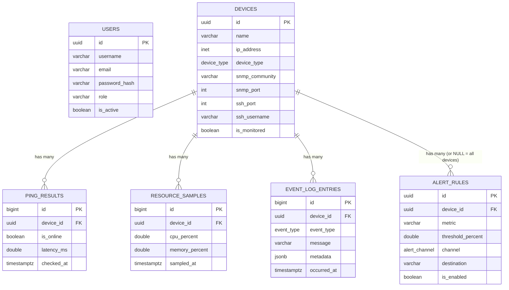

# Database

**Engine:** PostgreSQL 16+ (see `infrastructure/postgres/init.sql` for the
bootstrap schema; EF Core migrations in
`backend/src/NetworkMonitor.Infrastructure/Data/Migrations` own everything
after day one).

## Entity-relationship overview

## Tables

### `users`
Login accounts. `role` is a plain `varchar` (`Admin` / `Operator` /
`Viewer`) rather than an enum so new roles don't require a migration —
enforce the valid set in application code via `NetworkMonitor.Domain.Enums`
if you want compile-time safety on the C# side.

### `devices`
The switch/router/server inventory. `ip_address` uses Postgres's native
`inet` type (validates format, supports subnet operators later if you ever
want "devices in 10.0.0.0/24"). SSH credentials are **not** stored here —
`ssh_credential_ref` is a pointer (env var name, vault path, Docker secret
name) resolved at connection time by `SshInventoryService`. Never put a
raw password in this table.

### `ping_results`
One row per device per 30-second sweep. This is the highest-volume table
in the schema — see **Retention** below.

### `resource_samples`
One row per device per SNMP poll (CPU/RAM). Same volume concerns as
`ping_results`.

### `event_log_entries`
State-change audit trail: online→offline transitions, threshold breaches,
alerts sent, device added/removed/updated. `device_id` is nullable and
`ON DELETE SET NULL` so the log entry survives even if the device is later
deleted — you keep history of "device X was removed" instead of losing the
row along with the device. `metadata` is `jsonb` for anything
event-specific (e.g. `{ "previousCpu": 45, "newCpu": 94 }`) without needing
a new column per event type.

### `alert_rules`
Threshold configuration consumed by `AlertThresholdEngine` in the Worker.
`device_id = NULL` means "applies to every monitored device." `metric` is
`'Availability' | 'Cpu' | 'Memory'`; `threshold_percent` is ignored for
`Availability` rules (those fire on `consecutive_breaches` offline pings
instead of a percentage).

## Indexing rationale

- `ping_results (device_id, checked_at DESC)` and
  `resource_samples (device_id, sampled_at DESC)` — every chart and
  "latest status" query filters by device and orders by time descending;
  this is the one index that matters most for dashboard responsiveness.
- `devices (ip_address)` is `UNIQUE` — prevents accidentally monitoring the
  same box twice under two different names.
- `event_log_entries (event_type)` — supports the log viewer's "filter by
  event type" dropdown without a full scan.

## Retention (important once this runs for more than a few days)

At a 30-second ping interval, one device produces **2,880 rows/day** in
`ping_results`. Fifty devices is ~144,000 rows/day, ~4.3M/month. This is
fine for Postgres, but plan for one of:

1. **Partition by month** (`ping_results_2026_07`, etc.) and drop old
   partitions — cleanest long-term answer, worth doing once you're past the
   learning phase (step 10, "polish").
2. **A scheduled downsample job** — roll raw 30-second pings into
   hourly/daily aggregates (uptime %, avg latency) after N days, then
   delete the raw rows. Keeps chart queries fast without unbounded storage
   growth.
3. **A simple cron `DELETE ... WHERE checked_at < now() - interval '90 days'`**
   — the easiest starting point; not elegant, but correct, and enough while
   you're still building features 6–9.

Don't over-engineer this before you have the ping/SNMP pipeline actually
running — start with option 3 and revisit once you can see real row
volumes.

## Migrations vs. `init.sql`

`infrastructure/postgres/init.sql` only runs once, the very first time the
Postgres container starts with an empty data volume (Postgres's own
`docker-entrypoint-initdb.d` behavior). Treat it as a "day zero" bootstrap
— once EF Core migrations exist, schema changes should go through
`dotnet ef migrations add ...` and `dotnet ef database update`, not edits to
`init.sql`. Keeping both in sync manually will drift; if you want the two
to line up automatically at some point, generate an initial EF Core
migration from this schema and let `init.sql` be superseded entirely.

## Cross-references

- [architecture.md](./architecture.md) — which layer (API vs Worker) reads
  and writes each table
- [api.md](./api.md) — REST endpoints backed by these tables
- `infrastructure/postgres/init.sql` — the actual DDL